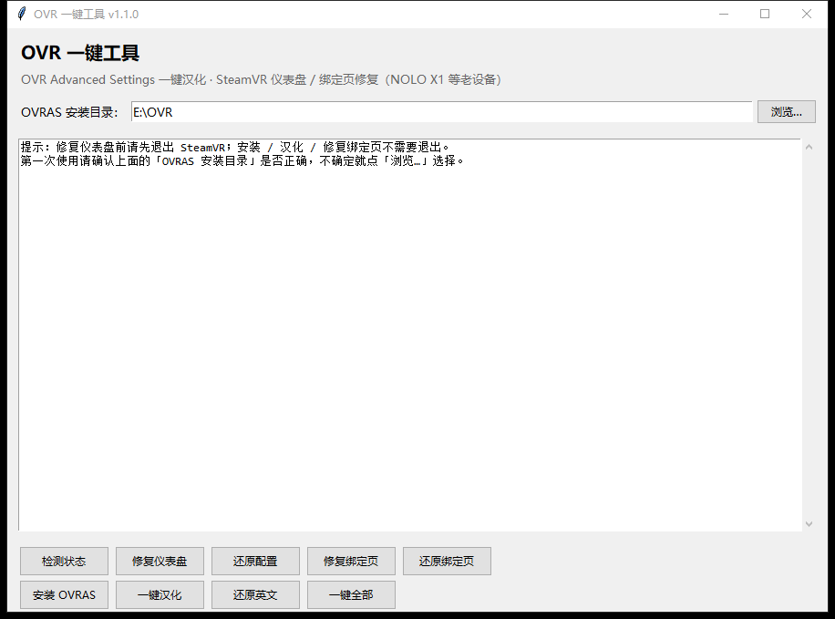

# OVR Advanced Settings 一键汉化

给 **OVR Advanced Settings (OVRAS)** 做中文界面的小工具，附带两个 SteamVR 兼容修复：**仪表盘修复**（主要针对 NOLO X1 这类老设备/串流套装）和**「绑定」页白屏修复**。

OVRAS 5.8.17 界面没有内置中文，本工具把 `res/qml` 下 56 个界面文件里的 249 条界面文本替换为简体中文，**改前自动备份、随时一键还原**。



## 三个功能

### 1. 一键汉化（主功能）

- 内置 249 条对照表，覆盖导航、按钮、对话框、统计页、绑定页等全部界面文本
- 只改界面文本，不动控件逻辑、颜色、模型和资源路径
- 品牌与技术名词保留原文：`OVR Advanced Settings`、`SteamVR`、`Oculus`、`ms`、`m/s`、`RSh~1…`、`Ctrl-C`
- 首次汉化自动备份英文到 `res/qml_en_backup`，点「还原英文」即可复原
- 重复执行安全：已汉化过的文件会跳过

### 2. 修复 SteamVR 仪表盘

> 这条是给 **NOLO X1 / Sonic 这类老设备**准备的兼容修复。

NOLO 的串流套装、网吧预设、某些"优化脚本"会把 SteamVR 仪表盘整个关掉：

```json
"dashboard": {
   "enableDashboard" : false,   // 仪表盘关了 → 按系统键没反应
   "showDesktop"     : false,   // 仪表盘里的"桌面"页签被隐藏
   "arcadeMode"      : true     // 街机模式，进一步裁剪仪表盘
}
```

结果就是：**按手柄系统键毫无反应，仪表盘进不去，里面的应用全都用不了**。

工具会把这三项改回可用状态（`enableDashboard=true`、`showDesktop=true`、`arcadeMode=false`），
修改前自动备份 `steamvr.vrsettings`，改完校验 JSON，失败可一键还原。

> 修好之后，仪表盘是用**手柄电源键（系统键）单击**呼出的。NOLO 手柄的菜单键只会发 `ApplicationMenu`，打不开仪表盘，这不是软件的锅。

### 3. 修复「绑定」页白屏

> 症状：仪表盘里点 OVRAS 的「绑定」，弹出的却是**一整片空白**，一个字都没有。

这不是汉化搞坏的，而是 SteamVR 2.18.x 绑定页自己的 bug（`controllerbindingui.js`）：

```js
// ReloadCurrentApp() 先把已知绑定清空
this.m_sLoadedBindingURI = void 0;
yield this.LoadActionManifest();
// 里面直接读 SteamVR 返回的 current_binding_url
null == this.m_sLoadedBindingURI && t.current_binding_url.hasOwnProperty(...)
```

当这个应用**没有用户自定义绑定**（OVRAS、很多自制应用都是这样）时，SteamVR 返回的
`current_binding_url` 是 `null`，于是抛
`TypeError: Cannot read properties of null (reading 'hasOwnProperty')`，整页渲染中断 → 白屏。
更麻烦的是崩掉的页面不会自动重载，之后每次看到都是那张白图。

工具会给这段加上空值保护，并在没有自定义绑定时**回落到应用自带的默认绑定**（也就是能直接看到并编辑按键表）：

- 修改前自动备份 `controllerbindingui.js`，点「还原绑定页」即可复原
- SteamVR **运行中也能打补丁**，重开一次「绑定」页即可生效
- 幂等：打过补丁的会跳过，不会重复改
- SteamVR 升级后文件被覆盖属正常现象，重新点一次「修复绑定页」即可

## 两种发行版

| 版本 | 说明 |
| --- | --- |
| **绿色版** `OVR-Toolkit.exe` | 单文件，免安装，双击即用，不需要 Python |
| **安装版** `OVR-Toolkit-Setup.exe` | 带安装向导，可选安装目录，创建开始菜单 + 桌面快捷方式 |

两个版本功能完全一致，绿色版适合放 U 盘/临时用，安装版适合长期使用。

## 使用方法

### 绿色版 / 安装版

1. 双击 `OVR-Toolkit.exe`
2. 第一次运行会提示选择 **OVRAS 安装目录**（会自动探测 Steam 版装在哪；探测不到就点「浏览…」自己选）
3. 点 **一键汉化**（会先自动备份英文）
4. 重启 SteamVR / OVRAS 即可看到中文

### 从源码运行

需要 Python 3.9+，无需第三方库：

```bat
run.bat                     :: 图形界面
python ovras_toolkit.py status    :: 查看状态
python ovras_toolkit.py localize  :: 汉化
python ovras_toolkit.py fix       :: 修复 SteamVR 仪表盘（先退出 SteamVR）
python ovras_toolkit.py bindfix   :: 修复「绑定」页白屏
python ovras_toolkit.py revert    :: 还原英文
```

完整命令：

```text
gui        图形界面（默认）
status     查看 SteamVR 配置 / 绑定页补丁 / OVRAS 安装与语言状态
fix        修复 SteamVR 仪表盘
restore    用最近一次备份还原 SteamVR 配置
install    下载并安装 OVRAS（--archive 支持本地 7z 离线安装）
localize   汉化（--dry-run 只预演）
revert     还原英文界面
backup     只备份英文界面
register   只把 OVRAS 注册进 SteamVR
bindfix    修复 SteamVR「绑定」页白屏（--dry-run 只预演）
bindrevert 还原绑定页原始文件
all        安装 + 汉化 + 修复仪表盘 + 修复绑定页
```

常用参数：`--dir 安装目录`、`--force`（SteamVR 运行中也强行改配置）。

### 图形界面按钮

| 按钮 | 作用 |
| --- | --- |
| 检测状态 | SteamVR 三项设置、绑定页补丁状态、OVRAS 是否安装、界面语言、备份数量 |
| 修复仪表盘 | 改配置 + 备份 + 校验（SteamVR 运行中会拒绝执行） |
| 还原配置 | 回滚到最近一次备份 |
| 修复绑定页 | 给 SteamVR 绑定页补空值保护（修白屏，运行中也可执行） |
| 还原绑定页 | 用最近一次备份还原 `controllerbindingui.js` |
| 安装 OVRAS | 下载官方最新版（免付费开源版）并注册进 SteamVR |
| 一键汉化 | 备份英文 → 替换中文 |
| 还原英文 | 用 `res/qml_en_backup` 复原 |
| 一键全部 | 安装 → 汉化 → 修复仪表盘 → 修复绑定页 |

## 安装路径

程序**不会自己猜盘符**：

1. 先读上次记住的目录（`config.json`）
2. 再自动扫描 Steam 库（`libraryfolders.vdf` + `steamapps/common`）找 Steam 版 OVRAS
3. 都没有就弹窗让你自己选

## 汉化细节

- 目标：`<OVRAS>/res/qml/**/*.qml`
- 只替换界面文本（`text:`、`headerText:`、`title:`、`dialogTitle:`、`showMessage("…")` 等）
- 替换后打印覆盖率，低于 80% 会警告（说明你的 OVRAS 版本不是 5.8.17）
- 还原：把 `res/qml_en_backup` 改回 `res/qml`，或点「还原英文」

## 自行构建

```powershell
:: 绿色版单文件 exe
powershell -ExecutionPolicy Bypass -File build\build_exe.ps1

:: 安装包（需要 Inno Setup 6，iscc.exe 在 PATH 或默认安装路径）
iscc installer\ovras-toolkit.iss
```

推送到 `main` 或手动触发 **Actions → build**，会自动产出绿色版和安装版；打 `v*` 标签还会自动创建 Release。

## 已知限制

- 对照表对应 OVRAS **5.8.17**（界面结构大改的版本只能部分覆盖）
- 修复仪表盘时需要**先完全退出 SteamVR**，否则退出时旧配置会被写回
- NOLO 手柄没有系统键，仪表盘要用**电源键单击**呼出
- 绑定页补丁针对 **SteamVR 2.18.x**；SteamVR 大版本升级后补丁会被覆盖，重新点一次「修复绑定页」即可（若代码结构变了工具会提示「版本未知」而不是乱改）
- 只在 Windows 上测试

## 更新日志

### v1.1.0

- 新增「修复绑定页」/「还原绑定页」：修掉 SteamVR 2.18.x 绑定页白屏（`current_binding_url` 为 null 时的 TypeError），并回落到应用默认绑定
- 「一键全部」包含绑定页修复；「检测状态」会显示补丁状态
- 界面按钮改成两行，避免窗口变窄时挤在一起

## 致谢

- [OVR Advanced Settings](https://github.com/OpenVR-Advanced-Settings/OpenVR-AdvancedSettings)（GPLv3）
- 汉化用词参考了 [VRCD 社区汉化补丁](https://docs.vrcd.org.cn/books/ovr-advanced-settings/page/ovr-advanced-settings-YHL)（Chaperone→防护墙、Space Drag→空间拖拽 等）

## 许可证

GNU GPLv3，与 OVR Advanced Settings 保持一致。
